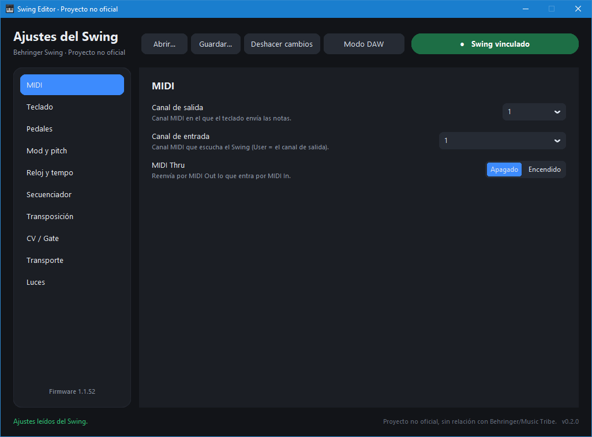

# Behringer Swing Unofficial editor

A Windows editor for the global settings of the **Behringer Swing**, written from scratch from the
device's own SysEx protocol. It reads every setting as soon as the Swing is plugged in and applies
each change right away, with read-back verification.

> [!NOTE]
> This is an unofficial project, not affiliated with or endorsed by Behringer, Music Tribe or Midas.
> It was built for interoperability, without copying any code or assets from the official editor.



---

## Features

* **Automatic linking**: finds the Swing as soon as it is plugged in by USB. No port to choose.
* **Live preview**: every change is sent to the Swing half a second after your last edit, and the app
  reads it back to check that it was stored correctly.
* **Settings, grouped in plain language** instead of one long list:

  | Section | Parameters |
  |---|---|
  | MIDI | In channel, Thru, Output channel |
  | Keyboard | Velocity curve, Velocity (as recorded / fixed), Fixed velocity, Aftertouch curve |
  | Pedals | Sustain pedal: function, mode, CC number, low/high values · Hold switch: function, mode |
  | Mod & pitch | Mod MIDI channel and CC, Pitch bend |
  | Clock & tempo | Clock mode, Clock start, Tap tempo count, Tempo knob |
  | Sequencer & arp | Next sequence, Arm to start, Sequencer random, Arpeggiator random |
  | Transposition | Input port, Input channel, Latch, Center pitch |
  | CV / Gate | Gate output, Pitch output, 0 V / 1 V notes, Note priority, Pitch range, Mod source, Mod max voltage |
  | Transport | Mode, Play/Pause, Play/Rec/Stop channels and CCs |
  | Lights | LED brightness |

* **DAW mode**: one click turns the Swing into a plain MIDI controller — keys, OCT−/OCT+, Hold, pitch
  bend and modulation on channel 1, and nothing else. Transport is off (so the Arp + Rec/Stop/Play
  clock-source combos leak nothing), transposition is off, the mod strip uses the standard CC 1, and
  MIDI Thru is off. It saves the settings it replaces, so one more click puts them all back.
* **Presets**: save and open your settings as `.json`, and restore what was on the Swing when it was
  connected.
* **Plain-language help text** under each setting.
* **English and Spanish**, following your Windows language.

## Requirements

* Windows 10 / 11
* A Behringer Swing connected by USB.

## How to use

1. Download `Swing.Editor.exe` from the [Releases](../../releases) page.
2. Close your DAW and Control Tribe: while the editor is open, the Swing stays linked to it, and
   Windows does not let another program use it at the same time.
3. Run the `.exe`. The status button turns to **Swing linked** and its current settings are loaded.
4. Change any setting. The Swing updates by itself, and the field shows the stored value once it is
   confirmed.
5. Use **Save…** to keep your settings in a file, and **Restore** to go back to what the Swing had when
   it was connected.

### Windows or the antivirus says the app is dangerous

The `.exe` is not digitally signed, so Windows SmartScreen shows "Unknown publisher". Click
**More info** → **Run anyway**.

A few antivirus engines flag apps made with PyInstaller as false positives. Every release `.exe` is
built by [GitHub Actions](../../actions) from the code in this repository, and each release includes a
`SHA256.txt` so you can check your download:

```powershell
Get-FileHash "Swing.Editor.exe" -Algorithm SHA256
```

## What this editor does not touch

* **Firmware updates.** The editor never sends the bootloader or firmware commands. Use Behringer's own
  Control Tribe for that.
* **The sequencer's 8 stored sequences.** Reading and editing individual steps needs the step data
  format decoded first; it is not part of this version.
* **The clock source (INT / MIDI / USB).** It is chosen with a button combination on the Swing itself
  (hold Arp 3–4 s, then Rec/Stop/Play/Tap) and is not a setting the Swing exposes over USB. See
  [research/PANEL_CONTROLS.md](research/PANEL_CONTROLS.md).

---

## Technical documentation

* [research/PROTOCOL.md](research/PROTOCOL.md): the Swing's SysEx protocol — the 47 known settings,
  their ids and ranges, the read/write pattern, and the commands the editor never sends.
* [research/MESSAGE_FLOW.md](research/MESSAGE_FLOW.md): what the Swing sends and receives over USB, and
  the crossings that can cause stuck notes or transport loops in a DAW.
* [research/PANEL_CONTROLS.md](research/PANEL_CONTROLS.md): the front panel controls and button
  combinations, mapped to what is (and isn't) visible over USB.
* [research/KEYBOARD_AND_DAW.md](research/KEYBOARD_AND_DAW.md): keyboard and DAW interaction notes from
  the research phase.
* [research/PLAN.md](research/PLAN.md): the project plan and phases.

### Safety rules

* **Allow-list only.** The editor only ever sends: product info (`00`), reads and writes of the 47
  known setting ids. It never sends `77` (enters bootloader mode), `74` (bootloader status), `73`
  (clears a sequence) or any firmware data.
* Every value is validated against its setting's range before being sent.
* A write only counts as done once reading it back returns the same value.

## License

MIT — see [LICENSE](LICENSE).
